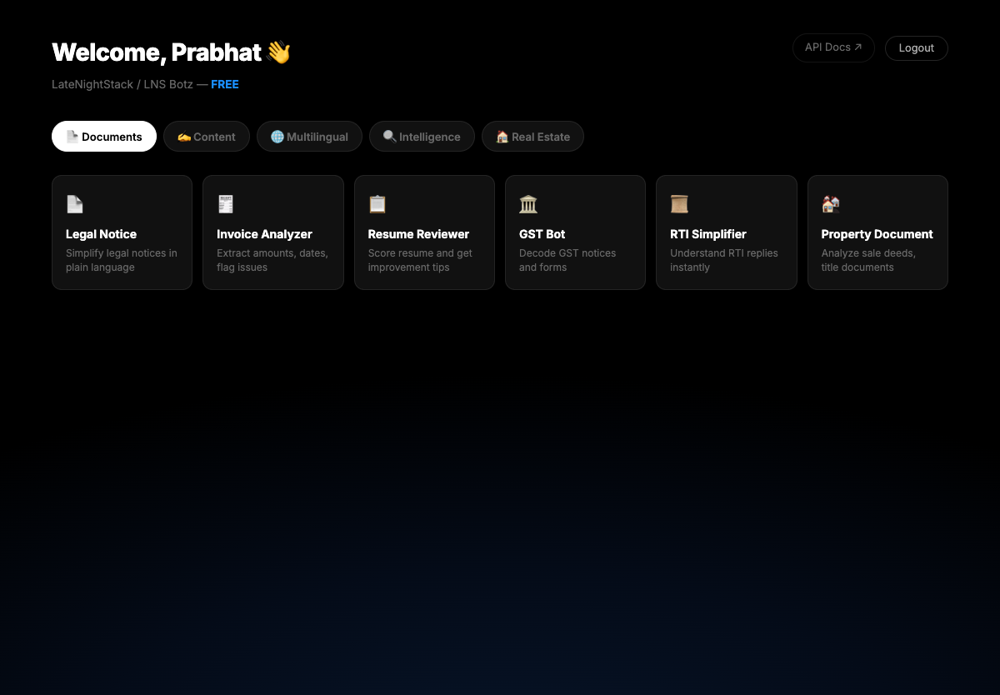

# LNS Botz

A FastAPI backend that packages several AI utilities behind one API with accounts, API keys, plans and payments: a Telegram assistant, a local-business lead agent, scheduled monitoring alerts, content transformation, and document, political, multilingual and property analysis. LLM calls go through a single gateway (Gemini by default) with caching, fallback and cost tracking.



System design: [docs/ARCHITECTURE.md](docs/ARCHITECTURE.md)

## Problem it addresses

Small businesses, creators and analysts in India repeatedly need the same few AI jobs done: answer customer messages, watch news and social sources for keywords, turn a video or PDF into posts or quizzes, and explain a legal notice or invoice in plain language. This project implements those jobs once as shared agents and exposes them as products, so adding a product is mostly configuration (`products/router.py`) rather than new infrastructure.

## What is in the repo

| Area | Path | What it does |
|---|---|---|
| API entry point | `main.py` | FastAPI app, CORS, per-API-key rate limit, routers, serves `frontend/index.html` |
| Shared core | `core/` | Config, async SQLAlchemy models, auth (JWT, API keys, Google OAuth, plan checks), billing (Razorpay, PayPal), AI gateway, Redis cache and session memory, Celery app, shared services (search, scraping, documents, translation, notifications) |
| Bots | `bots/` | `telegram` (webhook assistant with intents and memory), `business` (lead qualification and follow-ups), `monitoring` (scheduled source monitors and digests), `content` (transformations) |
| Agents | `agents/` | Reusable agents for `document`, `intelligence`, `political`, `property` and `translation` |
| Products | `products/router.py` | Catalogue of roughly 30 products routed to the agents and bots above |
| Frontend | `frontend/index.html` | Single-page landing, auth modal and dashboard |
| Infra | `infra/` | Dockerfiles, `docker-compose.yml` (API, worker, beat, Postgres/pgvector, Redis, Flower), ECS task definition, deploy and local setup scripts |
| Tests | `tests/e2e/` | Playwright browser scripts against a running deployment |

## Setup and run

Python 3.12 (see `infra/docker/Dockerfile`). You need Postgres and Redis.

```bash
python3 -m venv .venv && source .venv/bin/activate
pip install -r requirements.txt
cp .env.example .env     # then fill in values; SECRET_KEY must be at least 32 characters
```

Required at minimum: `SECRET_KEY` and `GEMINI_API_KEY` (the AI gateway refuses to start without it). Defaults for the database and Redis point at localhost (`core/config/settings.py`).

Start the data services and the API:

```bash
cd infra/docker && docker-compose up -d postgres redis && cd ../..
uvicorn main:app --reload          # http://localhost:8000
```

Background work (monitors, content queue) needs a worker and the scheduler:

```bash
celery -A core.queue.celery_app worker --loglevel=info
celery -A core.queue.celery_app beat --loglevel=info
```

`infra/scripts/setup_local.sh` automates the venv, `.env` and the Postgres/Redis containers. In `development` mode the app creates tables on startup and exposes `/docs`; in other environments the API explorer is disabled and CORS is restricted to the configured origins. Full stack in containers: `infra/docker/docker-compose.yml`.

## Tests

`tests/e2e/` holds Playwright scripts that drive a deployed site. They need `playwright` and a test account password supplied through the environment:

```bash
npm install
export LNS_TEST_PASSWORD='...'    # password of the test account the scripts log in with
node tests/e2e/lns_full_test3.js
```

There are no unit or integration tests yet (`tests/unit/` and `tests/integration/` are empty). Several scripts write screenshots to an absolute path under `/Users/xxvirusxx/PY/Bots/lns_screenshots`; adjust it for your machine.

## Configuration and secrets

All settings come from environment variables; `.env.example` lists every key. Real `.env` files are git-ignored. Do not commit `.env.production`.

## Limitations and next steps

- The scheduled `billing-usage-rollup` task points at `core.queue.billing_tasks.rollup_usage`, which does not exist, so Redis usage counters are never flushed to the database.
- Plan limits (bots, requests per day) are defined and reported, but the code only gates features with `require_plan` in the monitoring router. The daily rate limit setting is unused and the per-minute limit applies only to `X-API-Key` requests.
- The Telegram webhook accepts any POST for a valid bot id; it does not verify Telegram's secret token.
- `infra/docker/Dockerfile` runs `COPY . .` and there is no `.dockerignore`, so a local `.env` would be copied into the image. Add a `.dockerignore` before building images.
- The compose file uses a default Postgres password, publishes database and Redis ports, and runs Flower without authentication. Treat it as a development setup.
- Token counts in the AI gateway are estimated from character length, so recorded costs are approximate.
- `frontend/index.html` has a placeholder where customer testimonials should go; add real, attributable ones before launch.
- No benchmarks or usage numbers are included. TODO: add measured latency and cost per product.
- Add unit tests for the gateway, auth and billing signature checks, and a LICENSE.
